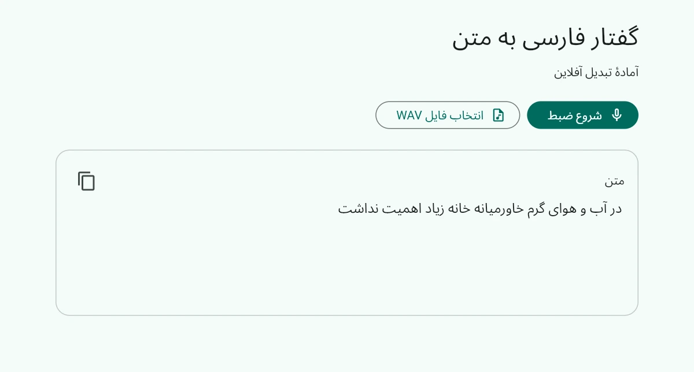

# farsi_speech_to_text

`farsi_speech_to_text` turns Persian speech into text in Flutter. Transcribe a WAV file or stream microphone audio for interim and final text. The package runs Mehdi Allahyari's Persian fine-tune of NVIDIA Nemotron with sherpa-onnx. Audio and transcripts stay on the device. Once the model is available locally, inference works offline.

## Quick start

The package requires Flutter 3.41 or later and Dart 3.11 or later. For a first run, try the example in Chrome or on macOS. The first run needs an internet connection and storage for the **666.6 MB** model download.

### Get your first transcript

Clone the repository and run the included app. The example was tested with Flutter 3.50.

```sh
git clone https://github.com/mahanpyk/farsi_speech_to_text.git
cd farsi_speech_to_text/example
flutter pub get
flutter run -d chrome
```

On macOS with the Flutter desktop toolchain configured, you can run `flutter run -d macos` instead. See the [example setup](example/README.md) for other devices.

1. [Download the 8-second Persian WAV][demo-wav]. It is already in the required mono, 16-bit PCM format at 16 kHz.
2. In the app, select **آماده‌سازی مدل** (Prepare model) and wait for the download to finish.
3. Select **انتخاب فایل WAV** (Choose WAV file), open `fa_ir_0320.wav`, and look under **متن** (Transcript). See the [example result](#demo) below.

### Add it to your Flutter app

From your app directory, install the dependency.

```sh
flutter pub add farsi_speech_to_text
```

On Android, iOS, macOS, Windows, and Linux, pass a writable model directory and the local path of a Persian WAV file to this function. For example, put the model in a subdirectory of `getApplicationSupportDirectory()` from [path_provider](https://pub.dev/packages/path_provider). Check the [native app configuration](#native-permissions) before downloading the model or opening files.

```dart
import 'dart:io';

import 'package:farsi_speech_to_text/farsi_speech_to_text.dart';

Future<String> transcribePersianWav(
  Directory modelDirectory,
  String wavPath, {
  void Function(double)? onDownloadProgress,
}) async {
  final model = FarsiModel.at(modelDirectory);
  try {
    await model.verify();
  } on FarsiModelException {
    await model.download(onProgress: onDownloadProgress);
  }

  return FarsiSpeechToText(model: model).transcribeWav(wavPath);
}
```

For Flutter Web, read the selected file as bytes and use the [browser API](#flutter-web).

## Demo

[Play the Persian input clip][demo-player] or [download the WAV][demo-wav]. The Flutter example in Chrome returned this text for that file.

> در آب و هوای گرم خاورمیانه خانه زیاد اهمیت نداشت



The clip is from [Google FLEURS](https://huggingface.co/datasets/google/fleurs), distributed under [CC BY 4.0](https://creativecommons.org/licenses/by/4.0/) and used here as provided by [FluidInference](https://huggingface.co/datasets/FluidInference/fleurs-full).

[demo-wav]: https://huggingface.co/datasets/FluidInference/fleurs-full/resolve/1cca811bb8ea4d370345f108f00518167040282c/fa_ir/fa_ir_0320.wav
[demo-player]: https://huggingface.co/datasets/FluidInference/fleurs-full/blob/1cca811bb8ea4d370345f108f00518167040282c/fa_ir/fa_ir_0320.wav

## Platform support

The package requires Flutter 3.41+ and Dart 3.11+. The example includes a runner for each platform listed below.

| Platform | Verified on the development toolchain |
| --- | --- |
| Android | Built a signed arm64 release APK |
| iOS | Transcribed a WAV in the iOS 26.5 simulator and built an unsigned arm64 release app |
| macOS | Transcribed WAV and chunked PCM on Apple Silicon and built a universal release app |
| Linux | Transcribed a Persian WAV using the native library on Debian arm64 in Docker |
| Windows | Transcribed a Persian WAV using the x64 native library under Wine |
| Web | Transcribed Persian WAV and streamed PCM in desktop Chrome 157 with both JavaScript and WebAssembly Flutter release builds |

Flutter verification used Flutter 3.50 and Dart 3.14. Linux and Windows verification covered the native libraries. The Flutter desktop runners still require a build and test on their respective host operating systems. See the [sherpa-onnx architecture matrix](https://pub.dev/packages/sherpa_onnx#supported-platforms).

## Install from a local checkout

To use a local checkout, add its directory to your app's `pubspec.yaml` and run `flutter pub get`.

```yaml
dependencies:
  farsi_speech_to_text:
    path: /path/to/farsi_speech_to_text
```

## Prepare the model

Use a writable directory dedicated to this model. Call `download()` when the user chooses to install the model. The initial download is **666.6 MB (635.7 MiB)**. Reuse a `FarsiModel` instance when transcribing multiple files to keep its successful integrity check cached.

- `isInstalled()` checks that all required files are present and match their expected sizes.
- `verify()` checks SHA-256 digests. Recognition calls it automatically on first use. Keep the verified files in place for the lifetime of that `FarsiModel` instance.
- `download()` fetches the pinned model and reuses files whose digests already match. Its optional callback receives a fraction from 0 to 1.
- To set up on an offline device, copy `encoder.int8.onnx`, `decoder.int8.onnx`, `joiner.int8.onnx`, `tokens.txt`, `LICENSE`, and `NOTICE` to the model directory. Use the exact files from the [pinned ONNX revision](https://huggingface.co/mentisialog/sherpa-onnx-nemotron-asr-streaming-farsi-1120ms-int8/tree/773e3d8f6ce043100a5dff6083271aa7811299bd).

The native recognizer uses two CPU threads by default. Set `numThreads` to a value from 1 to 32 to tune it for your device.

## Transcribe a WAV file

Call `transcribeWav` with the local path to a non-empty, mono, signed 16-bit PCM WAV file. This API loads the file into memory. For long recordings, decode the audio in chunks and use the streaming API.

To prepare another audio format or a stereo recording, convert it to mono PCM WAV first.

```sh
ffmpeg -i recording.m4a -ac 1 -ar 16000 -c:a pcm_s16le speech.wav
```

## Transcribe live PCM audio

Feed a `Stream<Uint8List>` of raw **16 kHz, mono, signed 16-bit little-endian PCM**. Each update contains the full hypothesis so far. Replace displayed text with the latest `FarsiTranscript.text`. Close the input to flush the remaining audio and receive one update with `isFinal` set to `true`. Cancel the result subscription to abandon the session.

```dart
import 'dart:typed_data';

import 'package:farsi_speech_to_text/farsi_speech_to_text.dart';

Future<void> transcribeLive(
  FarsiSpeechToText recognizer,
  Stream<Uint8List> pcmAudio,
  void Function(String text, bool isFinal) onTranscript,
) async {
  await for (final result in recognizer.transcribePcm16(pcmAudio)) {
    onTranscript(result.text, result.isFinal);
  }
}
```

The caller supplies the audio stream and handles microphone permission. The [example app](example/) uses [record](https://pub.dev/packages/record) with `AudioEncoder.pcm16bits`, `sampleRate: 16000`, and `numChannels: 1`.

### Native permissions

| Platform | App configuration |
| --- | --- |
| Android | Add `android.permission.RECORD_AUDIO` to the manifest and request runtime permission for microphone capture. Add `android.permission.INTERNET` for model downloads. |
| iOS | Add `NSMicrophoneUsageDescription` to `Info.plist` for microphone capture. |
| macOS | Add `NSMicrophoneUsageDescription` to `Info.plist`. For sandboxed apps, add `com.apple.security.device.audio-input` for capture, `com.apple.security.network.client` for downloads, and `com.apple.security.files.user-selected.read-only` when using a picker to read WAV files. |
| Linux and Windows | Check the OS settings and follow the platform setup for your chosen recorder. |

## Flutter Web

Use `FarsiWebSpeechToText` to transcribe a selected WAV file's bytes or a microphone PCM stream. It runs the same model in a Web Worker using WebAssembly. Serve the app over HTTPS in production or use localhost for development. The browser needs Worker support, WebAssembly SIMD, and sufficient quota in its Origin Private File System (OPFS) for the model. [Origin-private file storage](https://fs.spec.whatwg.org/#origin-private-file-system)

```dart
import 'dart:typed_data';

import 'package:farsi_speech_to_text/farsi_speech_to_text.dart';

Future<String> transcribeBrowserWav(Uint8List wavBytes) async {
  final recognizer = FarsiWebSpeechToText();
  try {
    await recognizer.prepare();
    return await recognizer.transcribeWavBytes(wavBytes);
  } finally {
    recognizer.dispose();
  }
}
```

For live audio, use `transcribePcm16` with the same mono, 16 kHz PCM format as the native API. Run one transcription at a time per recognizer. Reuse it for subsequent sessions and call `dispose()` when finished.

The first preparation downloads the 666.6 MB model. The browser stores it in OPFS for that origin. Clearing site storage removes the cached model. Model preparation also requires memory to verify and load the weights. Start with a current desktop Chromium browser and measure peak memory on the browsers and devices you target. Deploy and cache the Flutter app and WebAssembly runtime assets as well if the page needs to open offline. [Flutter Web build guide](https://docs.flutter.dev/platform-integration/web/building)

The default model source is Hugging Face. To serve the model from a mirror, pass its directory URL to `modelBaseUri` and host the exact pinned files with byte-range support. For a cross-origin mirror, allow the app's origin using CORS and expose `Content-Range`.

The browser API reports malformed audio as a `FormatException` and unavailable browser capabilities, a failed download, or overlapping recognition as a `StateError`. For browser microphone capture, use your recorder's browser permission flow.

Build with `flutter build web` or `flutter build web --wasm` and serve the entire `build/web/` directory. Serve JavaScript assets as JavaScript and `.wasm` assets as `application/wasm`. [Flutter WebAssembly deployment guide](https://docs.flutter.dev/platform-integration/web/wasm#serve-the-built-output-with-an-http-server)

## Native errors

| Error | Meaning |
| --- | --- |
| `FarsiModelException` | A model file is missing, truncated, or has an unexpected digest. Call `download()` to repair the model, or restore the pinned files. |
| `FileSystemException` | The WAV path or the model storage is inaccessible. `FarsiModelException` is a subtype, so catch it first when distinguishing the two. |
| `FormatException` | The WAV could not be decoded, or the PCM stream ended midway through a sample. |
| Network or timeout error | The download did not complete. Check connectivity and retry `download()`. |

Stream errors arrive on the result stream. Wrap an `await for` loop in a `try`/`catch`, or set `onError` on the subscription.

## Model, privacy, and app size

The package uses the `fa-IR` prompt and the INT8 ONNX export with a 1.12-second look-ahead. The model typically writes numbers as words and uses limited punctuation. Recognition runs on the CPU in a background isolate on native platforms. The initial HTTPS transfer fetches model files from Hugging Face. Recognition reads local model files and audio.

The package archive, the compiled app, and the model occupy different amounts of space. To measure the package's contribution to an app, compare release builds with the same Flutter SDK, build settings, and target architecture. App stores can further process release artifacts for a device. [Flutter app size guide](https://docs.flutter.dev/perf/app-size)

| Item | How to measure |
| --- | --- |
| Source archive | From the package root, run `dart pub publish --dry-run` and read the reported compressed size. |
| Release artifact | For Android, build with `flutter build apk --release --split-per-abi` and measure the APK for your target ABI. On macOS, build with `flutter build macos --release` and measure the resulting app bundle. For iOS, `flutter build ios --release --no-codesign` gives a local unsigned bundle for comparison. |
| Model files | Sum the byte sizes of the six installed files. The pinned model occupies **666,586,386 bytes** in file content. |

### Example release measurements

These are local builds with Flutter 3.50 and Dart 3.14. The baseline keeps the same demo UI and other dependencies and replaces recognition with stubs. Sizes use decimal megabytes (MB). The model is a separate download.

| Platform and artifact | Baseline | With recognition | Increase |
| --- | ---: | ---: | ---: |
| Android arm64 APK | 16.48 MB | 44.15 MB | 27.67 MB |
| iOS arm64 app bundle (unsigned) | 16.22 MB | 42.88 MB | 26.66 MB |
| macOS universal app bundle (arm64 + x86_64) | 42.56 MB | 101.50 MB | 58.94 MB |

Native builds exclude the web worker and its WebAssembly assets. The browser worker loads **15.36 MB** of raw JavaScript and WebAssembly recognition runtime assets in the JavaScript release build. The transfer size depends on HTTP compression and caching.

### Accuracy and memory

Mentisialog reports **15.1% word error rate** over 50 Persian FLEURS clips as recorded and about **1.7 GB peak RAM** on an Apple M4 with two CPU threads. Those measurements apply to the exporter’s setup. Check performance and peak memory with your audio on the devices you plan to support. [ONNX model benchmarks](https://huggingface.co/mentisialog/sherpa-onnx-nemotron-asr-streaming-farsi-1120ms-int8#accuracy-and-speed-indicative)

## Acknowledgments and licenses

Thank you to **Mehdi Allahyari (مهدی اللهیاری)** for adapting NVIDIA Nemotron for Persian and sharing the training, evaluation, and inference code. This package uses the Persian model developed in his repository. [Original repository](https://github.com/mallahyari/nemotron-asr-streaming-farsi) · [Original model card](https://huggingface.co/mehdi-hf/nemotron-asr-streaming-farsi)

Thanks to Mentisialog for the INT8 ONNX export and to the sherpa-onnx contributors for the inference runtime. This package and the original repository code use Apache 2.0. The downloaded model uses NVIDIA's OpenMDW License Agreement 1.1. Model downloads include the model's `LICENSE` and `NOTICE` files. [Package license](LICENSE) · [ONNX export and license](https://huggingface.co/mentisialog/sherpa-onnx-nemotron-asr-streaming-farsi-1120ms-int8#licence-and-attribution) · [sherpa-onnx](https://github.com/k2-fsa/sherpa-onnx)

## Contributing

See the [contributor guide](CONTRIBUTING.md) for pull requests, local validation, and author review.
